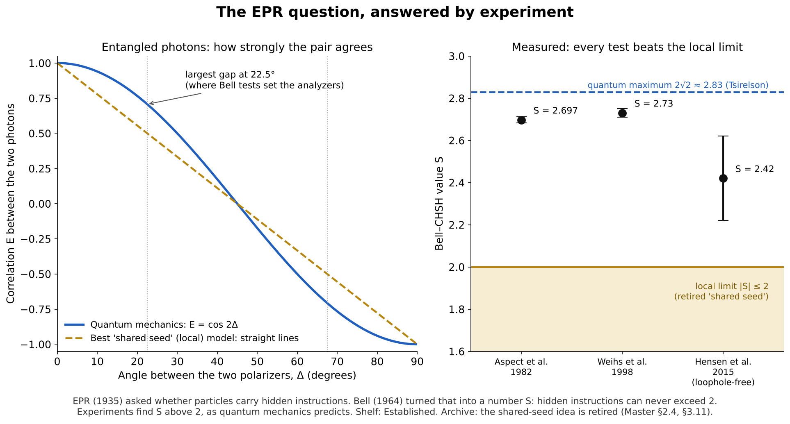

# The EPR Paradox: the verdict

**Shelf: Established.** Print-friendly: [EPR-Paradox-Verdict.pdf](EPR-Paradox-Verdict.pdf) (two pages).
You are welcome to print it, or upload it to any AI assistant and ask your own questions.



## The question (1935)
Einstein, Podolsky and Rosen asked whether two particles from one source carry hidden instructions,
a "shared seed," that fix every result in advance. If so, quantum mechanics would be incomplete.

## How it became testable (1964)
John Bell turned the question into a number, S. Any model with hidden instructions and no faster-than-light
influence (a *local hidden-variable* model) must give **|S| ≤ 2**. Quantum mechanics predicts up to
**2√2 ≈ 2.83** (Tsirelson's bound).

```
|ψ⁻⟩ = ( |↑↓⟩ − |↓↑⟩ ) / √2
E(a, b) = −cos θ             (spin-½)        E(α, β) = −cos 2(α − β)   (photons)
|S| ≤ 2  under Bell's assumptions            |S| ≤ 2√2  in quantum mechanics
P(A = ±1 | a, b) = ½   for every b           (no signalling)
```

## The verdict (experiments)
| Experiment | Measured S | Note |
|---|---|---|
| Aspect, Grangier and Roger, 1982 | 2.697 ± 0.015 | Photons, beyond the local limit |
| Weihs et al., 1998 | 2.73 ± 0.02 | Settings chosen fast and far apart |
| Hensen et al., 2015 (Delft) | 2.42 ± 0.20 | First loophole-free test |

Several loophole-free tests followed in 2015. The Nobel Prize in Physics 2022 went to John Clauser,
Alain Aspect and Anton Zeilinger for this work.

**Verdict:** local hidden-variable models, the "shared seed," are ruled out. No signal travels between the
particles: each side alone sees 50/50 results, whatever the other side does. How to *interpret*
entanglement remains open.

## What Uniquea retired, and what it keeps open
| Claim in the archive | Label |
|---|---|
| Entanglement is a shared seed or "DNA script" from the common source | **Contradicted.** A local hidden-variable model; simulated, \|S\| = 2.000 against the quantum 2.828 |
| 360/127 ≈ 2√2 | Coincidence (0.22% apart). The Tsirelson bound is exact |
| EPR Double-Fulcrum: one bilateral state, two measurements | Candidate interpretation; standard quantum mechanics relabelled, no new prediction |
| A field wake carries the entanglement from A to B | **Withdrawn** (it would allow signalling) |
| Derive the 2√2 cap from the structure of the plenum | Open target |

The retirement is a design requirement for Uniquea: its quantum layer cannot be local hidden variables.

## Two notes for reusing the figure
- With S = E(a,b) + E(a,b′) + E(a′,b) − E(a′,b′), photon settings a = 45°, a′ = 0°, b = 22.5°, b′ = 67.5° give −2√2.
  With the minus sign on E(a,b′), use a = 0°, a′ = 45°.
- For spin-½ the Bloch-sphere angle equals the lab angle; for photons the Poincaré-sphere angle is twice the
  lab angle. That is the whole factor of 2.

*Source in the archive: Master §2.4 and §3.11 ([master/Uniquea-Master-Public.md](../master/Uniquea-Master-Public.md)).*
