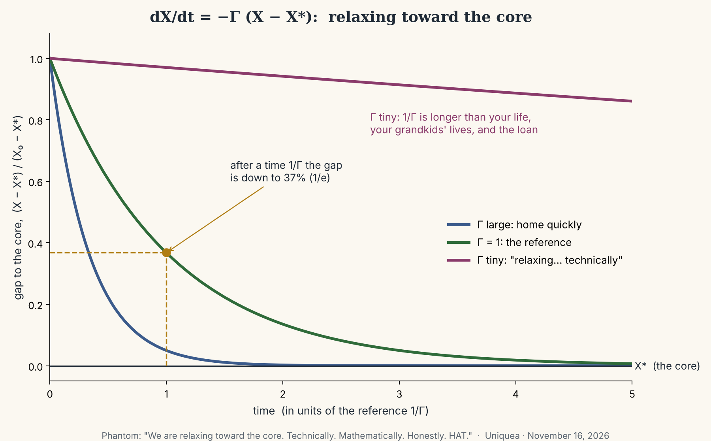

# Gamma: Relaxing Toward the Core

**Label:** Claude 5.2 Uniquea Field Observations UFO

*Uniquea · November 16, 2026 · Stephen M. Griffin (Phantom.O.Vanish) · ORCID 0009-0005-8386-3999 · UFO-029*

> In CCPBH language, that is Gamma so small it might as well be zero.
>
> **dX/dt = −Γ (X − X\*)**
>
> If Γ is tiny, Phantom says: "We are relaxing toward the core. Technically. Mathematically. Honestly. HAT."
>
> "But 1/Γ is longer than your life. Longer than your grandkids' lives. Longer than the loan."

## In plain words

X is any quantity; X\* is where it is headed, "the core." The law says: the farther X is from the core, the faster it moves toward it, and Γ (Gamma) sets how fast. A large Γ brings X home quickly. A tiny Γ still brings it home, but so slowly that nobody alive, nor their grandchildren, will see it arrive. (CCPBH is Uniquea's term, Cold Crunch Primordial Black Hole.)

## The math

| Line | Meaning |
|---|---|
| dX/dt = −Γ (X − X\*) | The rate of change is proportional to the gap, and points toward the core |
| X(t) = X\* + (X₀ − X\*) · e^(−Γt) | The solution: the gap shrinks exponentially |
| τ = 1/Γ | The time constant: after one τ the gap is down to 1/e, about 37% |
| t½ = 0.693/Γ | The half-life: the time to close half the gap |
| after 5τ | Less than 1% of the gap remains |

For any Γ greater than zero, X does approach X\*. It never quite arrives; it gets as close as you care to wait for.

## Technically. Mathematically. Honestly.

- **Technically:** a tiny Γ is still a Γ. The system is relaxing.
- **Mathematically:** the solution above approaches X\* for every positive Γ, however small.
- **Honestly:** if 1/Γ is far longer than the time available, nothing measurable moves. The universe is about 4.4 × 10¹⁷ seconds old; a Γ far below 10⁻¹⁸ per second has barely begun. "Might as well be zero" is the honest reading.

The three words are the label: Honest, Accurate, Truth.

## Where it comes from in the record

- **July 1, 2026 (Planck 1500 Ledger, "Old Math, New Math"):** the same law, written dJ/dt = −(kπ²/c⁸)(J − J\*). So Γ = kπ²/c⁸.
- **November 5–10, 2026:** the Orb's wobble obeys the same form at the other extreme: strong damping, γT ≈ 810 (UFO-002), with the damping derived from an energy-conserving bath (UFO-006).
- **One law, two regimes:** the wobble dies quickly; the drift to the core barely moves.

## HAT

- **Established:** the equation is the standard law of exponential relaxation. The same law describes a cooling cup of coffee (Newton's law of cooling), a discharging capacitor, and radioactive decay.
- **Derived:** the solution, the time constant and the half-life.
- **Postulated:** that Γ = kπ²/c⁸ with a particular k. *Caution:* π²/c⁸ is 1.5 × 10⁻⁶⁷ in SI units, but that number changes with the units chosen. Γ must carry units of 1/time, so k carries the rest, and "tiny" has meaning only when Γ is compared with another rate, such as 1 over the age of the universe.
- **Humor:** "Longer than the loan." A debt that relaxes on a time longer than the loan is, on the books, never repaid.

## What would settle it

A value of k fixed independently, giving a Γ that can be compared with a measured rate. Until then the regime (fast, or "might as well be zero") is the owner's premise.
