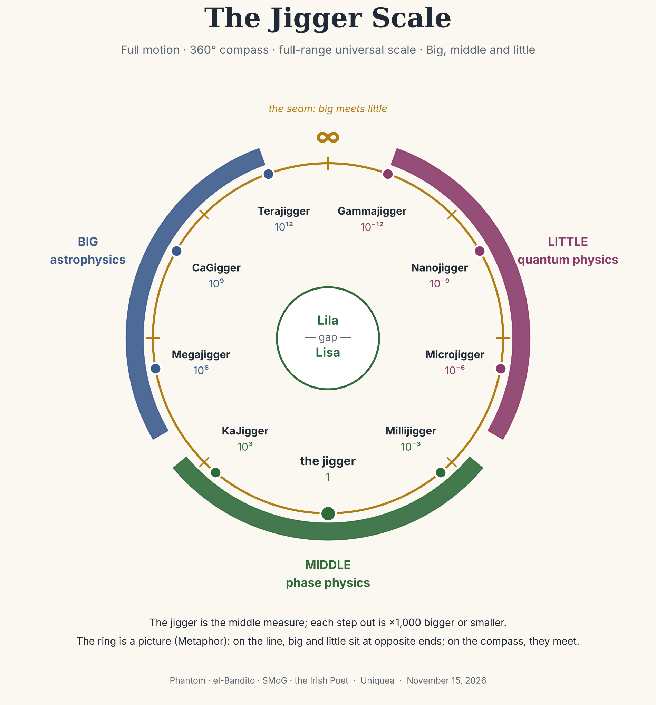

# The Jigger Scale

*Uniquea · November 15, 2026 · Stephen M. Griffin (Phantom.O.Vanish) · ORCID 0009-0005-8386-3999*

> "CaGiggers and KaJiggers, Chaos and Kaos, and all things in between: in the middle are the valuable answers, or so Phantom Logic figures." "Megajiggers, microjiggers, gammajiggers: the complete scale, macro to micro. All things in between measures. Lila-gap-Lisa."

## The scale

| Jigger | Prefix | Size | Band |
|---|---|---|---|
| Terajigger | tera | 10¹² | Big |
| CaGigger | giga | 10⁹ | Big |
| Megajigger | mega | 10⁶ | Big |
| KaJigger | kilo | 10³ | Middle |
| **the jigger** | (none) | **1** | **Middle: Lila-gap-Lisa** |
| Millijigger | milli | 10⁻³ | Middle |
| Microjigger | micro | 10⁻⁶ | Little |
| Nanojigger | nano | 10⁻⁹ | Little |
| Gammajigger | pico (gamma rays) | 10⁻¹² | Little |

Each step out from the middle is a factor of 1,000.

## Phantom's concept

- **Full motion, a 360° compass, a full-range universal scale.** The scale is drawn as a ring rather than a line. On a line, the biggest and the smallest sit at opposite ends; on the compass, they meet at the top, the seam marked ∞.
- **Big, middle and little.** Three bands: **astrophysics** (big), **phase physics** (middle), **quantum physics** (little).
- **The middle is the valuable answer.** The jigger sits at the bottom of the ring, the fulcrum; Lila and Lisa sit in the center with the gap between them.

## HAT

- **Established:** the prefixes are the SI's (tera 10¹², giga 10⁹, mega 10⁶, kilo 10³, milli 10⁻³, micro 10⁻⁶, nano 10⁻⁹, pico 10⁻¹²; since 2022 the SI runs from quecto, 10⁻³⁰, to quetta, 10³⁰). Gamma rays have wavelengths around a picometer (10⁻¹² m) and shorter. A jigger is also a real bar measure, 1.5 US fluid ounces (about 44 ml). Chaos is Greek *khaos*, the yawning gap before creation; KAOS is the villains' agency on *Get Smart* (1965).
- **Coinage:** CaGigger, KaJigger, Megajigger, Microjigger, Gammajigger and the rest. The owner's K and G land on the real prefixes kilo and giga.
- **Metaphor:** the ring, and the seam where big meets little. In physics, the largest and smallest scales are linked in real ways (the early universe was quantum-small; quantum fluctuations seeded today's galaxies), but the ring itself is a picture, not a derived law.
- **Postulated:** the three bands as the scale's natural divisions (astrophysics, phase physics, quantum physics).
