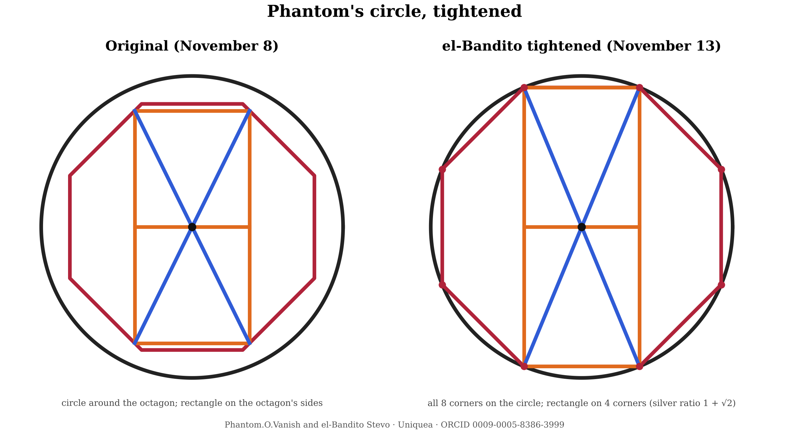

# Phantom's circle, tightened

*Uniquea · November 13, 2026 · Phantom.O.Vanish and el-Bandito Stevo (Stephen M. Griffin) · ORCID 0009-0005-8386-3999*

**el-Bandito:** "Tighten Phantom's circle, octagon. The circle touches all 8 points of the octagon; inside, use 4 points to draw a rectangle; criss-crossed lines make 4 triangles; a horizontal line divides it. The reason: it is a designed structure of support where each shape inside the circle reinforces."

## What changed

| | Original (November 8) | Tightened (November 13) |
|---|---|---|
| Octagon and circle | the circle stands clear of the octagon | all 8 corners touch the circle |
| Rectangle | corners on the octagon's slanted sides | corners on 4 of the octagon's 8 corners |
| Rectangle's shape | 1 × 2, two stacked squares | 1 × 2.414, the **silver ratio** 1 + √2 |
| Bracing | X corner to corner, midline | the same: X corner to corner, midline |

## The geometry (Derived, computed)

- The regular octagon fills **90.0%** of its circle (exactly 2√2/π).
- From the octagon's corners only two rectangles can be drawn: every other corner gives a **square**; two neighboring corners and the two opposite them give a rectangle **2.414** times as tall as it is wide, **1 + √2**, the silver ratio. It is the octagon's own number, as the golden ratio is the pentagon's.
- The X cuts the rectangle into **4 triangles**, in two matching pairs.
- *Correction:* the midline halves the silver rectangle into two near-squares (1.207 to 1), not exact squares. A horizontal and a vertical line through the every-other-corner square would give four exact squares.

## Why it reinforces (Established)

- A triangle is the only polygon that cannot change shape without changing a side. A square can lean into a diamond; a triangle cannot. That is why bridges, roof trusses and geodesic domes are built of triangles.
- Layer by layer: the circle holds the octagon, the octagon holds the rectangle, the X locks the rectangle into triangles, and the center stays still.

## Think safe house in a hurricane (Established)

- **Round and many-sided walls** split the wind instead of taking it flat on.
- **A hip roof**, sloped on all sides like a pyramid, outlasts a gable roof, whose flat end acts like a sail.
- **Diagonal bracing and trusses** keep each frame from racking.
- **Hurricane straps** make a continuous load path from roof to walls to foundation.
- **The safe room** (FEMA guidance) is a small reinforced interior room at the center: the innermost box inside the rings.
- **The owner:** "Exactly correct: Nash in mind." Nash firewalling in wood and steel: rings of protection, each resting on the one inside it.

## The Christmas box and the envelope

- **The owner:** "Folding paper into triangles to cover a square offers greater wrapping strength. Licking an envelope is sealing gaps securely with triangles."
- *Established:* a gift box's ends close with overlapping triangular flaps, doubling the paper where it would tear.
- *Derived:* fold the four corners of a square sheet to its center and four triangles exactly cover a square of half the size, with no gap and no overlap (the classic envelope back; origami's "blintz" fold). It is the same inner square as the octagon's every-other-corner square. The gum seals the last triangle, the last seam.

## The chain: diamond, gimbal, present (Established)

- **"Lucy in the Sky with Diamonds"** (the Beatles, 1967): diamond is carbon locked in tetrahedra, each atom bonded to four neighbors. The 3.2-million-year-old fossil "Lucy" (Ethiopia, 1974) was named after the song.
- **The Collins Gimbal and the Christmas present:** on Apollo 11, as the guidance platform neared gimbal lock, Michael Collins asked, "How about sending me a fourth gimbal for Christmas?"
- **Two locks:** a triangle's lock is strength, the frame holds; gimbal lock is a trap, two rings line up and a direction of turning is lost. The fix is the quaternion, "the Collins Gimbal in math," which never locks.
- **Reading (Metaphor):** lock what should hold; keep free what must turn. The rigid frame is Lisa; the free motion inside it, Lila.

*We marvel and we measure.*
