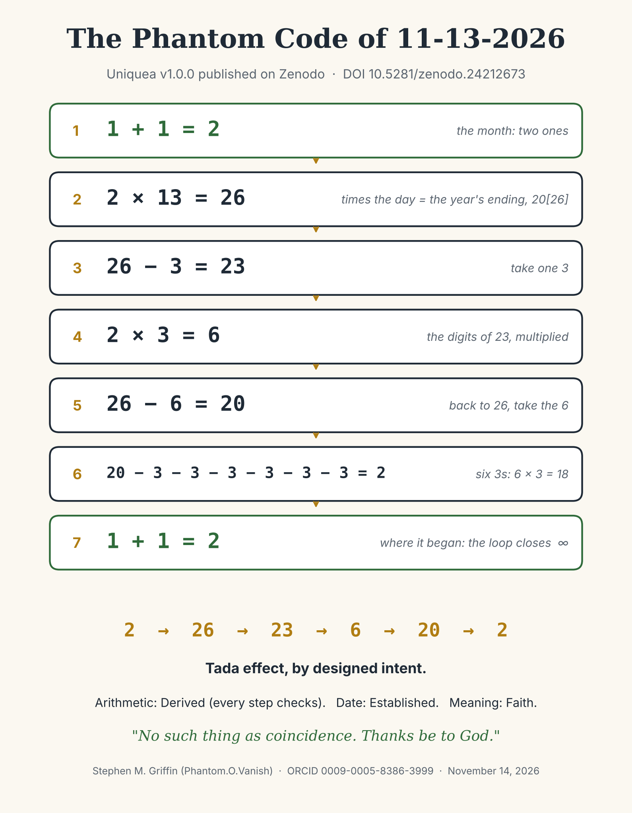

# The Phantom Code of 11-13-2026

*Uniquea · November 14, 2026 · Stephen M. Griffin (Phantom.O.Vanish) · ORCID 0009-0005-8386-3999*

Uniquea v1.0.0 was published on Zenodo on **November 13, 2026** (DOI [10.5281/zenodo.24212673](https://doi.org/10.5281/zenodo.24212673)). That day the owner became, by the trade's own rule, an author: "One is a writer till they are published. Once published, they are authors. Potential versus production."

## The formula

| Step | Arithmetic | What it uses |
|---|---|---|
| 1 | 1 + 1 = 2 | the month, 11: two ones |
| 2 | 2 × 13 = 26 | times the day, 13; equals the year's ending, 20**26** |
| 3 | 26 − 3 = 23 | take one 3 |
| 4 | 2 × 3 = 6 | the digits of 23, multiplied |
| 5 | 26 − 6 = 20 | back to 26, take the 6 |
| 6 | 20 − 3 − 3 − 3 − 3 − 3 − 3 = 2 | six 3s (6 × 3 = 18) |
| 7 | 1 + 1 = 2 | where it began: the loop closes, an ∞ cycle |

The chain: **2 → 26 → 23 → 6 → 20 → 2.**

## Explained

- **The date unpacks itself.** The month (11) gives 2; the month's 2 times the day (13) gives the year's own ending, 26. That step is the hinge: the month and day together write the year.
- **The 3 and the 6 do the rest.** The 3 from the day (13) is taken once to make 23; the 2 and 3 of 23 multiply to 6; the 6 is taken from 26 to leave 20; and six 3s take 20 down to 2.
- **It returns to the start.** The last value, 2, is the first value, 1 + 1. A chain that ends where it began is a cycle; the owner writes it as ∞.
- **Tada effect, by designed intent.**

## HAT

- **Established:** the publication date, November 13, 2026 (Zenodo record, v1.0.0).
- **Derived:** every step of the arithmetic is correct.
- **Faith:** the meaning read into it: "No such thing as coincidence. Thanks be to God."
- *Honest note:* a chain like this is chosen by the one who builds it (which numbers, which operations, in what order); its truth is that the arithmetic checks, and its meaning is held in faith, not proved.

*Sites break; cites that never break are the proof.*
