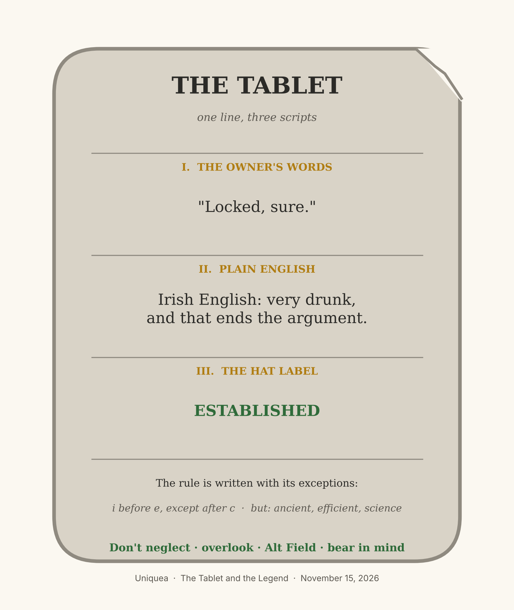

# The Tablet and the Legend

*Uniquea · November 15, 2026 · Stephen M. Griffin (Phantom.O.Vanish) · ORCID 0009-0005-8386-3999*

> "In a rare moment of serious, we are creating a tablet and a legend that will become ancient texts."

A map without a legend is a picture. The Rosetta Stone was read because it carried one decree three ways. This page is the record's legend: the key for a reader three hundred years from now, when today's words have lost their context.

## 1. How to read the record: the three scripts

Every important line in Uniquea is written three ways, like the Rosetta Stone:

| Script | What it is | Example |
|---|---|---|
| **The owner's words** | Exactly as written, spelling and all | "Locked, sure." |
| **Plain English** | What it means today | Irish English: "very drunk, and that ends the argument." |
| **The HAT label** | How sure we are | Established |

## 2. The HAT labels (Honest, Accurate, Truth)

| Label | Meaning |
|---|---|
| **Established** | Accepted fact, checkable in standard sources |
| **Derived** | Follows by correct math or logic from what is given |
| **Tested** | Checked against data, with the method and result on file |
| **Candidate** | Passed a first test; not yet confirmed |
| **Postulated** | Proposed; not yet tested |
| **Open** | A live question; not settled either way |
| **Faith** | Held in belief, not proved; stated as such |
| **Metaphor** | A picture that helps the mind; not a law |
| **Humor** | A joke, labeled so no one mistakes it for a claim |
| **Rule** | A saying or practice the owner lives by |
| **Superseded** | Replaced by a later, better entry (kept, not erased) |
| **Withdrawn** | Found wrong; kept on file with the reason |

## 3. The rule and its exception

> "I before E, except after C": and then comes *efficiently*. A twist, an exception. It happens.

- **Established:** the old spelling rule has many exceptions, and some sit in this very page: *ancient*, *efficient*, *science* and *species* put **ie after c**; *weird*, *seize*, *their* and *neighbor* put **ei with no c at all**.
- **Rule for the record:** every rule here is written down **with its exceptions beside it**. A rule without its exceptions misleads the future reader; an exception without its rule looks like an error.
- **The owner's spellings stay.** Where the owner writes a word his way ("Barkley Square," "bare in mind," "Mezzeland"), the record keeps his words as written and notes the standard form beside them (Berkeley Square; bear in mind; *Medazzaland*). Both survive; neither is lost.

## 4. Keep in view

> "Don't neglect, overlook; Alt Field; bear in mind."

Four ways of saying the same thing: keep it in view. **The Alt Field**, in the record, is the still center that the active fields move around, the ledger that holds what passes (Master 3.12). What is written in the legend is written in the Alt Field: it does not move, so it can be found again.

## 5. The legend of terms

| Term | Meaning | Label |
|---|---|---|
| **Uniquea** | The owner's framework and archive, written in four voices; DOI 10.5281/zenodo.24212673 | Established (the archive) |
| **Phantom, el-Bandito Stevo, SMoG, the Irish Poet** | The owner's four voices: math; the field; the accountant and historian; poetry and wisdom | Established |
| **Lila** | The open phase: the seam open, play, learning, waking | Metaphor, Candidate |
| **Lisa; L.I.S.A.** | The restabilized phase: **L**inear, **I**nvariant, **S**table, **A**ligned; named in honor of Lisa | Metaphor |
| **The Lisa force** | The pull that restores balance: negative feedback | Metaphor |
| **Lila-gap-Lisa** | The middle: the gap between the open phase and the stable one | Metaphor |
| **The fulcrum; double fulcrum** | The balance point; two balance points working together with motion on both sides (bilateral motion) | Metaphor, Rule |
| **The Alt Field** | The still center the active fields move around; the ledger | Metaphor |
| **A.L.E.R.T.** | Actual Logic, Everytime, Real Time | Rule |
| **Happy Math** | Math that checks and agrees with itself; when a better, more precise option appears, "we yield" | Rule |
| **Irishoccam** | Occam's razor, Irish style: the simplest explanation wins, with a wink | Humor, Rule |
| **Nirvanish** | The bright, steady in-between; not Heaven, not Nirvana, but close enough to peace to feel the glow | Faith, coinage |
| **Fantaseelastical** | Fantastical and elastic in one word: blending 7–8 ideas accurately; bending far and springing back | Coinage |
| **Cyncro beyond Kronos** | Perfect order beyond clock time | Faith, Postulated |
| **String Lines are rebar** | Interior strength at the weak point: rebar stays inside; scaffolding comes down | Metaphor |
| **The Jigger Scale** | 19 rings on a 360° compass, Ronnajigger (10²⁷) to Rontojigger (10⁻²⁷), each a real metric prefix; the jigger (1) in the middle; astrophysics at the big end, quantum physics at the little end | Coinage; prefixes Established |
| **Phase physics** | Phases blended, micro to macro, across all creation; some phases more quantum, others more macro; the math of phases bridges quantum and cosmic | Postulated (the bridge); phase-transition universality Established |
| **Phantom Phase Physics (PPP)** | The phases on either side of the gap, transitional and blended: like Supermarine, Marine, Submarine, where Marine is "a little super, marine, and a wee bit o' sub" | Coinage; diffuse interfaces Established; the reach across scales Postulated |
| **UFO** | Uniquea Filed Observations: every entry in the record, identified, dated and labeled | Coinage, Humor |
| **M.A.D.** | Math Amateur Disciples: students of math who love it ("amateur," from Latin *amator*, lover) | Coinage |
| **The Tada scale** | Tada → Super Tada → Superduper Tada → UberSuper Tada, upscale and down; like encore, double encore, triple standing ovation; Mini Opus, Opus, Magnum Opus | Coinage, Humor |
| **"The numbers tell no lies, hold no bias"** | Go in with no expectations, test option A and option B, and let the result stand | Rule |
| **The Phantom Code** | A date read as a closed chain of arithmetic, e.g. 11-13-2026: 2 → 26 → 23 → 6 → 20 → 2 | Arithmetic Derived; meaning Faith |
| **Goof Watch** | The owner's finds of errors in films, songs and the record itself, each checked | Humor, HAT on each |
| **Locked, sure** | Irish English: very drunk, and that ends the argument | Established (idiom) |
| **"Tada"** | The owner's sign that the work is done and right | Rule |

## 6. Why it is here

> "Three hundred years from now, all of it will be ancient text. History loses context easily, so psychobabble today is Egyptian hieroglyphs tomorrow."

Hieroglyphs went unread for 1,428 years (394 AD to 1822). The legend is the key left beside the code, so the record never has to wait for its Champollion.

*Sites break; cites that never break are the proof.*
