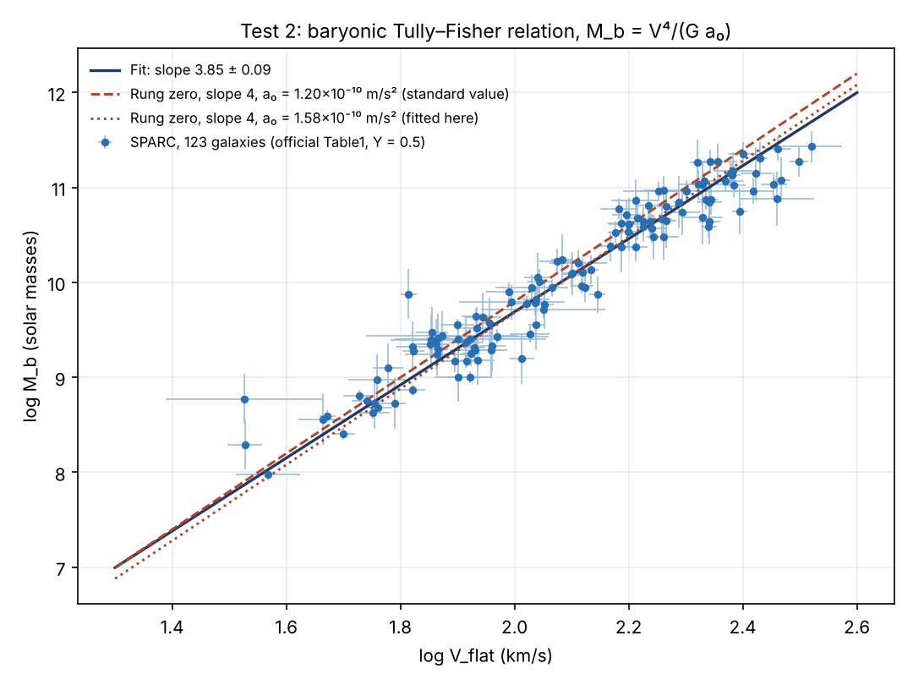

# Test 2: the baryonic Tully–Fisher relation against SPARC

*Uniquea · run November 9, 2026 · Stephen M. Griffin (Phantom.O.Vanish) · ORCID 0009-0005-8386-3999*

**Status: Tested (provisional).** The slope-4 prediction holds up against the data without being confirmed. Its a₀ comes out the same size as Test 1's.

## The prediction

Test 1 checked rung zero (deep MOND, g_obs = √(a₀ g_bar)) point by point along rotation curves. The same rule makes a second prediction for whole galaxies. Where the curve goes flat at speed V_flat, the visible (baryonic) mass must be

**M_b = V_flat⁴ / (G a₀)**, so log M_b = 4 log V_flat − log(G a₀): a straight line of slope exactly **4**.

This is the baryonic Tully–Fisher relation (BTFR). The test can fail in two ways: the slope can differ from 4, or the a₀ it needs can differ from Test 1's.

## Data and method

- **Data:** the official SPARC Table1, `SPARC_Lelli2016c.mrt` (Lelli, McGaugh and Schombert, 2016, AJ 152, 157), supplied by the owner. It matches the mirror copy used in Test 1 in all 175 of 175 rows.
- **Benchmark:** Lelli, McGaugh, Schombert, Desmond and Katz, 2019, MNRAS 484, 3267. For V_flat they report N = 123, slope 3.85 ± 0.09, intercept 1.99 ± 0.18, orthogonal intrinsic scatter 0.026 ± 0.007 dex, and observed scatter 0.24 dex. They also say systematics allow a slope of 3.5 to 4.0.
- **Cuts (as in the benchmark):** Q < 3, inclination ≥ 30°, and V_flat measured (the 5% flatness rule, already applied in the table). That leaves **123 galaxies**, the same count.
- **Mass:** M_b = 1.33 M_HI + Υ L[3.6], with Υ = 0.5 and also 0.4 and 0.6.
- **Mass errors:** flux, distance (2δD/D), 0.11 dex scatter in Υ, and 10% on the HI mass. The 10% is an approximation of the benchmark's error equation.
- **Speed errors:** the table's error plus the inclination term V·δi / tan i.
- **Fit:** maximum likelihood with constant intrinsic scatter, as in the benchmark. The posterior is mapped with a plain Metropolis MCMC (numpy only).
- **Two likelihoods** are reported: the benchmark's orthogonal one and the vertical one. Which one is "right" is a known open choice, and it moves the slope.

Run it with `python3 btfr_sparc.py <SPARC_Lelli2016c.mrt> results.json`, then `python3 plot_btfr.py <SPARC_Lelli2016c.mrt> results.json btfr_sparc.png`.

## Results

**Reproduction check (orthogonal, Υ = 0.5):** slope **3.85 ± 0.09**, intercept 2.00 ± 0.18, σ⊥ 0.029 ± 0.006 dex, observed scatter 0.24 dex. This matches the published fit, so the pipeline is sound.

| Υ_disk | Slope (orthogonal) | Slope (vertical) | Chance slope ≥ 4 (orthogonal) | a₀ at slope 4 (×10⁻¹⁰ m/s²) |
|---|---|---|---|---|
| 0.4 | 3.75 ± 0.08 | 3.53 ± 0.08 | 0.1% | 1.79 |
| **0.5** | **3.85 ± 0.09** | 3.63 ± 0.08 | 5% | **1.58** |
| 0.6 | 3.93 ± 0.08 | 3.71 ± 0.08 | 20% | 1.42 |

- **Slope:** 4 is allowed but not required. With the benchmark's method it is 1.7σ above the fit at Υ = 0.5 and within 1σ at Υ = 0.6. The vertical method excludes 4. The choice of method (about 0.2) and of Υ (about ±0.09) each matter as much as the statistical error.
- **a₀ with the slope held at 4:** 1.58 × 10⁻¹⁰ m/s² at Υ = 0.5 (statistical ±4%; 1.42 to 1.79 for Υ 0.6 to 0.4). The spread from galaxy to galaxy is 0.25 dex.
- **Against Test 1:** Test 1 gave 1.31 (deep, our cut) and 1.39 (deep, published cut) at Υ = 0.5. Test 2's a₀ is 14–20% higher, inside the ±15–30% Υ systematic already on file. Two different routes give the **same size of a₀**.
- **Intrinsic scatter** is small (about 0.03 dex), consistent with deep MOND's prediction of none. That number leans on how well the errors are known, so it is suggestive, not decisive.
- **cH₀/2π = 1.04 × 10⁻¹⁰** (H₀ = 67.4) sits further from Test 2's a₀ (which is about 50% higher) than from Test 1's. That lead stays a lead and is not strengthened.

## What it means

- **Not a fail.** Unlike a random guess, the slope could easily have come out 3 or 5, and the a₀ could have been ten times off. Neither happened.
- **Not a confirmation of "exactly 4."** The data allow 4 under some reasonable choices and not others.
- **Not unique to rung zero.** Dark-matter models also produce a tight BTFR, though how naturally they do so is debated. Test 2 shows that rung zero survives a second, independent check; it does not rule anything out.
- **Credit:** the relation and the data belong to Tully and Fisher (1977), McGaugh and colleagues (2000 onward), and the SPARC team. Milgrom predicted slope 4 in 1983. This test re-checks their work with Uniquea's rung zero; it does not discover anything new.

## Limits

- V_flat values are taken from the table, not refitted from the rotation-curve files.
- The mass error model approximates the benchmark's; the 10% HI error is an assumption.
- Distance and inclination are not marginalized galaxy by galaxy.
- The fit uses a simple MCMC, not emcee; the reproduced benchmark numbers serve as the check.
- Next: rerun with the official Rotmod files; then BIG-SPARC (about 3,882 galaxies) when its curves are public.

## For kids

A heavier galaxy spins faster, and the rule says by how much: double the speed means sixteen times the stuff (2 × 2 × 2 × 2). We checked 123 real galaxies. The rule came out close: the real "power" is about 3.85, and the rule says 4. The magic number a₀ came out about the same as in Test 1. Two different ways of asking, nearly the same answer.
