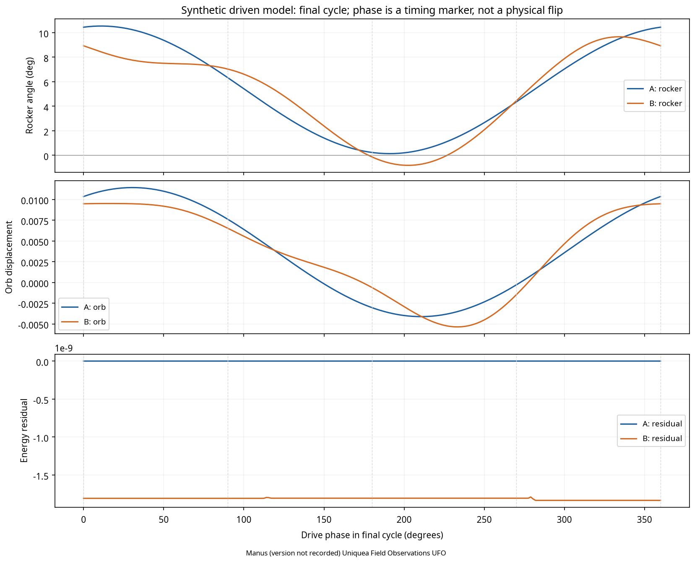

# Three upper scopes, lower trim and bilateral fulcra: synthetic test

**Label:** Manus (version not recorded) Uniquea Field Observations UFO

**Status: an independently constructed, actively driven, dimensionless toy model; not empirical validation, not a reconstruction of archived field equations.** The three upper scopes share a load with other model elements, a fourth small-control scope is associated with a lower trim, and the orb and *both* fulcra have their own inertia and bidirectional spring forces. These are proposed mathematical meanings for the owner's words, not statements about their literal geometry or physics.

## Crucial naming distinction

The **new local Option A** here is a *linear* rocker-restoring law; the **new local Option B** is a smoothly hardening *nonlinear* rocker-restoring law. **This is not the earlier Option A/B fork.** In [`../Orb-Adiabatic-Check/README.md`](../Orb-Adiabatic-Check/README.md), Option A means **no damping** and Option B means **damping γ with the lost energy transferred to an Alt Field/bath**. The earlier files make different statements about a different system. Both new alternatives here use the **same nonzero damping and actuator controls** and differ only in the specified restoring response. We integrate passive dissipation into a bookkeeping bath, but do **not** model a physical Alt Field, its microscopic dynamics or its feedback. An unforced zero-damping *conservation check* is included; this is not a full replication of the earlier fork.

An earlier, separately prepared four-compass proposal was also consulted. It describes another synthetic candidate with a bilateral orb/fulcra, four points and two named bridges, an active oscillator and optional gates. That proposal is not included in this folder. This package is a simpler independent mechanical surrogate: it does **not** implement those bridges, gates, oscillator, vortex, archived potential or claimed archival equations. It is not a revision or validation of that prior model.

Start with [`RESULTS.md`](RESULTS.md) for the three checks and publication safeguard. The separately parameterized [`geometry/technical_note.md`](geometry/technical_note.md) calculates a center of mass, candidate pivot, gravitational torque and conventional gimbal axes. It uses illustrative SI masses and distances, **not** the dimensionless parameters in the driven model; the two are independent examples, not one jointly validated mechanism. [`FORK_LEDGER.md`](FORK_LEDGER.md) records the new alternatives without changing the older archive's ledger. [`EXTENDED_TESTS.md`](EXTENDED_TESTS.md) records the orthogonal orb-damping sweep and scope-controller ablations.

## State and equations

There are eight dynamic coordinates, each with its own velocity:

```
q = (theta, y, fL, fR, s1, s2, s3, s4)
```

`theta` is the scalar rocking angle in radians. `y` is the orb's scalar displacement, `fL` and `fR` are the left/right fulcrum displacements, `s1`–`s3` are upper-control displacements, and `s4` is lower trim. All are dimensionless and time is a model time unit; coefficients and lever arms are synthetic. Each lever is a dimensionless displacement-per-radian map, not a measured length. A positive constant load produces the negative torque `-L` on the rocker. There is only one rotational degree of freedom: **“upper/lower” is a control role, not a resolved 3D location or spatial gimbal mechanism.** No range, impacts, frictional contact, mechanical stops, travel limits, actuator force limits, stresses or gravity field are modeled.

Let `b=(-0.7, +0.7)` denote opposite fulcrum lever signs, and `a=(1,1,1,1)` the scope lever signs. The stored potential is

```
U = Urock(theta) + L*theta + (ky/2)*y^2 + (kq/2)*(fL^2+fR^2)
  + sum_j (kf_j/2)*(fj - bj*theta)^2
  + sum_j (ko_j/2)*(y - fj)^2
  + sum_i (ks_i/2)*(si - ai*theta)^2.
H = (1/2)*sum_l mass_l * qdot_l^2 + U
mass_l * qddot_l = -dU/dq_l - damping_l*qdot_l + F_l
```

`F_l` is zero except for the four scope coordinates. Every coupling spring is generated from one potential: e.g., orb force from the left spring is `-ko_L*(y-fL)` and the reciprocal fulcrum force is `+ko_L*(y-fL)`. Thus the orb and both fulcra affect each other and the rocker; they are not preprogrammed backgrounds. The left and right orb-coupling stiffnesses differ (0.8 versus 1.15) intentionally, so an otherwise symmetric rocking input does not cancel the orb response identically. The `L*theta` potential is the ideal conservative work of a constant external load; the energy reference is arbitrary, so `H` can be negative.

The external, active controllers have independent forces

```
ri(t) = bias_i + amplitude_i*sin(omega*t + phase_i)
Fi = kp_i*(ri(t) - si) - kd_i*sdot_i.
```

They **do not prescribe** the evolving scope positions. The three upper target amplitudes are 0.35; the lower trim target amplitude is 0.035. Their measured response amplitudes are reported below. The target biases are `(0.25,0.25,0.25,0)`; load torque is 0.28. Exact remaining inertias, damping, stiffnesses, controller gains, initial conditions, and solver settings are in `model.py` and saved in `output/summary.json`. The parameters were chosen to make this thought experiment observable; none are measured or fitted.

### Precisely defined A/B transition

For A, `Frock = -k*theta` and `Urock = k*theta^2/2`. For B, let `r=|theta|`, `h=clamp((r-0.10)/(0.24-0.10),0,1)` and `S(h)=6h^5-15h^4+10h^3`. Then

```
Frock_B = -k*theta*(1 + 1.5*S(h)),      k=1
Urock_B(theta) = integral from 0 to |theta| of k*x*(1 + 1.5*S(h(x))) dx.
```

The exact piecewise polynomial antiderivative is implemented in `rocker_energy`. The two laws are identical for `|theta| <= 0.10` rad, transition smoothly between 0.10 and 0.24 rad, and B is `2.5` times the A restoring force magnitude above 0.24 rad. The force and its first two derivatives are continuous across the boundaries. Both options use exactly the same initial conditions, masses, damping, load, couplings, target signals and controllers. In the final reported cycles B reaches only `|theta|=0.16863`, so it enters the transition but does **not** reach its upper saturated branch. A is evaluated against the same angular thresholds only as a reference; it has no transition in its law.

### Four-way phase and what actually rocks

The four smooth sinusoidal target phases are `0°, +90°, 180°, 270°` (= `-90°`) relative to the first target. The stage boundaries `0/90/180/270/360°` are **time-phase markers**, not jumps in the force and not physical angular positions. A side at +90° and another at -90° relative to a common zero are **180° apart**, not 90° apart; 90° total separation instead means, for example, phases `-45°` and `+45°`. For the illustrative mapping, upper control 2 is the +90° target and lower trim is the -90° target. This is a control-phase choice, not proof of a left/right geometry. Actual responses need not have the target phases, and are separately measured by a sine/cosine fundamental fit.

The rocker reverses smoothly when `thetadot=0`. In the final cycle the linear rocker stays on the positive side of zero while the nonlinear rocker crosses zero twice. Neither comes close to a ±90° physical angle or turns upside down: this is **rocking with smooth reversals**, not a successful literal tip-flip or 3D gimbal inversion.

## Reproduce without network calls

Python 3.12.3 with the installed versions in `requirements.txt` was used. The standard-library `unittest` runs the tests; NumPy, SciPy, and Matplotlib are needed. With those dependencies already available:

```sh
cd tests/Four-Way-Gimbal-Transition
OPENBLAS_NUM_THREADS=1 python3 -m unittest -v
OPENBLAS_NUM_THREADS=1 MPLBACKEND=Agg python3 model.py
OPENBLAS_NUM_THREADS=1 python3 sensitivity.py
OPENBLAS_NUM_THREADS=1 python3 axes_radix_checks.py > output/axes_radix_checks.json
OPENBLAS_NUM_THREADS=1 python3 damping_transition_probe.py
OPENBLAS_NUM_THREADS=1 python3 ablation.py
python3 geometry/calculate_gimbal.py
```

The scripts do not access the network or write outside this directory. Running them replaces generated files under `output/`. `model.py` uses SciPy DOP853, 20 cycles at `omega=0.75`, 240 samples per cycle, `rtol=1e-9`, `atol=1e-11`, maximum step 0.08. The convergence rerun uses `rtol=2e-11`, `atol=2e-13`, maximum step 0.04. Each physical initial state is `(0.06,0.035,-0.015,0.025,0.20,0.20,0.20,0)` with all initial velocities and ledger variables zero. The perturbation run increases both initial `theta` and `y` by 0.04 and leaves everything else unchanged.

## Numerical results for the stated synthetic parameters

All extrema below are sample-based (240 points per cycle), and turning/zero-crossing times in JSON are linearly interpolated between samples. The final cycle is cycle 20; all motion remains actively driven.

| Diagnostic | New A: linear | New B: nonlinear |
|---|---:|---:|
| Final-cycle rocker min/max, radians | 0.002379 / 0.183932 | -0.014270 / 0.168631 |
| Final-cycle rocker min/max, degrees | 0.136 / 10.538 | -0.818 / 9.662 |
| Final-cycle orb displacement min/max | -0.004123 / 0.011440 | -0.005362 / 0.009518 |
| Final-cycle left fulcrum min/max | -0.057297 / 0.003187 | -0.065977 / 0.026695 |
| Final-cycle right fulcrum min/max | -0.006317 / 0.058275 | -0.022323 / 0.057581 |
| Three upper response half-ranges | 0.27638, 0.29359, 0.26771 | 0.27793, 0.29155, 0.26622 |
| Lower trim response half-range | 0.03154 | 0.03188 |
| Actual scope 2 phase vs scope 1 | +84.50° | +84.93° |
| Actual scope 4 phase vs scope 1 | -89.70° | -89.09° |
| Actual scope 2–4 wrapped phase difference | 174.19° | 174.02° |
| Final-cycle physical-state closure norm | 9.80e-9 | 2.07e-9 |
| Max physical-state difference vs tighter solver | 4.11e-10 | 1.70e-9 |

The response phases are least-squares **fundamental** phases; nonlinear response has additional harmonics. These are not exactly ±90°, despite the exact target timing. The full rocker turning and zero-crossing times are in `output/summary.json`; A has two turning points and no zero crossing in the final cycle, B has two of each. Closeness of a single final cycle to repetition is finite-time numerical evidence of entrainment to the external signal, not proof of a limit cycle, asymptotic stability, or self-sustaining behavior. Neither Floquet multipliers nor basin/global stability are evaluated.



For the initial perturbation, the physical-state Euclidean norm (mixing normalized coordinates and their velocities) starts at `0.05657`; it can transiently grow to `0.09256` (A) or `0.09262` (B). At the end of cycles 1, 5 and 20 it is respectively `0.03236`, `0.000883`, `1.87e-9` (A) and `0.03774`, `0.000663`, `8.96e-10` (B). The same time-dependent control is applied to baseline and perturbed runs. This is one finite-time perturbation, not a comprehensive stability test; end values are close to solver-resolution limitations. The full time histories are `output/perturbation_A.csv` and `output/perturbation_B.csv`.

### Load sharing, stages and smooth transitions

In the final cycle, the mean torque from the **three upper scopes combined** is `+0.46166` (A) or `+0.47477` (B), opposed by constant load `-0.28`. The means of lower trim / fulcra / rocker-restoring torque are `-0.04517 / -0.04333 / -0.09316` (A) and `-0.04301 / -0.04126 / -0.11050` (B). Mean rocker inertia and its own viscous torque complete the instantaneous and time-averaged balance. The upper scopes **share** the load with springs, fulcra, trim and inertia, rather than being claimed to cancel the load on their own. Positive and negative instantaneous torques are not motor efficiencies.

The following are final-cycle stage boundary angles in radians; `Wnet` is the signed sum of all four controller works in each stage. These are sequential quarters of the drive cycle, not instantaneous switching events:

| Drive phase | A theta start → end | B theta start → end | A Wnet | B Wnet |
|---|---:|---:|---:|---:|
| 0–90° | 0.18228 → 0.11039 | 0.15584 → 0.12270 | +0.02444 | +0.02116 |
| 90–180° | 0.11039 → 0.00403 | 0.12270 → -0.00236 | -0.09492 | -0.08738 |
| 180–270° | 0.00403 → 0.07592 | -0.00236 → 0.07749 | +0.11465 | +0.11827 |
| 270–360° | 0.07592 → 0.18228 | 0.07749 → 0.15584 | +0.02669 | +0.02083 |

For the first-cycle boundaries the angles are, in order, A `0.06000, 0.21273, -0.06642, 0.12013, 0.15387` and B `0.06000, 0.17689, -0.03748, 0.10160, 0.14868`. All 80 stages per option, including per-stage energy, torque components, orb range and sampled nonlinear-transition occupancy, are saved in `output/stages.csv`. Occupancy fractions include both stage endpoints and are therefore sampling approximations, not exact crossing durations.

### Energy ledger and bath

For each actuator we integrate separately `Wplus_i = ∫max(Fi*sdot_i,0)dt` and `Wminus_i = ∫max(-Fi*sdot_i,0)dt`. We integrate `Qbath = ∫sum_l damping_l*qdot_l^2 dt` as nonnegative passive damping energy. The modeled accounting is

```
H(t)-H(0) = sum_i Wplus_i - sum_i Wminus_i - Qbath
H(t) + Qbath + sum_i Wminus_i - sum_i Wplus_i = H(0).
```

The bath is an ideal cumulative **ledger**, not a physical field or heat reservoir with independent temperature, dynamics, feedback or specified storage mechanism. Negative actuator work is tracked as energy **extracted from the mechanical system**; whether it is dissipated, stored, or regenerated is not modeled. Controller electronics, reference-signal generation, supply and efficiency are not modeled, so mechanical actuator input is not total real-world electrical consumption. Damping inside the controller force is included in its signed work and is not double-counted in `Qbath`.

Over all 20 cycles:

| Model-unit ledger quantity | A | B |
|---|---:|---:|
| Total positive actuator work | 7.393774 | 7.545007 |
| Total negative work magnitude | 5.802427 | 5.932211 |
| Net mechanical actuator work | 1.591347 | 1.612796 |
| Passive damping to bookkeeping bath | 1.480335 | 1.502774 |
| Mechanical energy change | +0.111012 | +0.110022 |
| Maximum sampled absolute ledger residual | 5.60e-12 | 1.83e-9 |

The maximum difference in the **gross cumulative ledger states** between normal and tighter solver runs is `1.44e-6` (A) and `5.87e-7` (B), larger than the mechanical-state differences: splitting power with `max()` introduces kinks in those auxiliary integrals, and numerical cancellation can hide gross-work errors in the net ledger. These are numerical comparison results, not rigorous bounds. With all controllers disabled but damping retained, the final mechanical energy decreases and the bath gains `0.08622` (A) or `0.08424` (B); no external drive sustains the motion. A zero-damping, no-controller test independently checks approximate total-energy conservation. No pump or source is postulated.

## Testing and deliverables

`tests.log` records **9/9 tests passing**: force/energy gradient consistency, reciprocal orb–fulcrum forces, limiting and transition smoothness, initial phase geometry, instantaneous energy identity, unforced damped and lossless controls, per-stage ledger, and a tighter-solver one-cycle comparison. These tests establish properties of this code, not empirical validation. The frequency probe `sensitivity.py` runs both alternatives at 0.9× and 1.1× the baseline drive frequency with all other parameters common; its results are `output/sensitivity.json`. A sparse one-parameter check is not a robustness envelope or optimization. No conclusion that B is generally superior follows from these results.

The first continuity test used a one-sided finite-difference step of `2e-5` and missed its first-derivative tolerance by about `4.9e-8`; halving the step reduced the measured discrepancy from `1.05e-6` to `2.62e-7`, and the full suite then passed. This changed only the test discretization, not the model equations or results.

At `omega=0.675`, the final-cycle RMS rocker angle is 0.11123 (A) versus 0.10574 (B), and 20-cycle net controller work is 1.41553 versus 1.40036. At `omega=0.825`, the RMS is 0.11651 versus 0.10607, while 20-cycle net work is 1.78358 versus 1.80966. The net-work ordering changes with frequency. These 20-cycle durations differ in model time, so the work totals compare options at the same frequency, not absolute power across frequencies. RMS uses the 241 sampled final-cycle points including both endpoints. In A, the reported transition-occupancy field is only a comparison against B's angular thresholds; A itself has no transition.

- `model.py`, `test_model.py`, `sensitivity.py`, `requirements.txt`: executable sources and dependencies.
- `output/summary.json`: all parameters, software versions, 20-cycle comparisons, work by controller, numerical checks and passive controls.
- `output/trajectory_A.csv`, `output/trajectory_B.csv`: sampled state, velocity, energy, work and residual over the complete run.
- `output/stages.csv`: all phase stages in both cases.
- `output/perturbation_A.csv`, `output/perturbation_B.csv`: complete perturbation-distance histories.
- `output/final_cycle.png`: final-cycle rocker, orb and cumulative ledger residual plotted against the drive phase.
- `axes_radix_checks.py`, `damping_transition_probe.py`, `ablation.py` and their tests: the gimbal-axis, positional-radix, orb-damping and scope-ablation controls. Full results are in `output/axes_radix_checks.json`, `output/damping_transition.json`, `output/ablation.json` and `output/trajectories.npz`.
- `model_run.log`, `tests.log`, `sensitivity_run.log`, `all_26_tests.log`: recorded execution output.

No SPARC mapping, observed data, three-dimensional kinematics, real actuator supply or experimental calibration was attempted. A full interpretation would require an agreed geometry, units, physical source and sink, measured parameters, independent observations, and explicit validation against alternatives.
