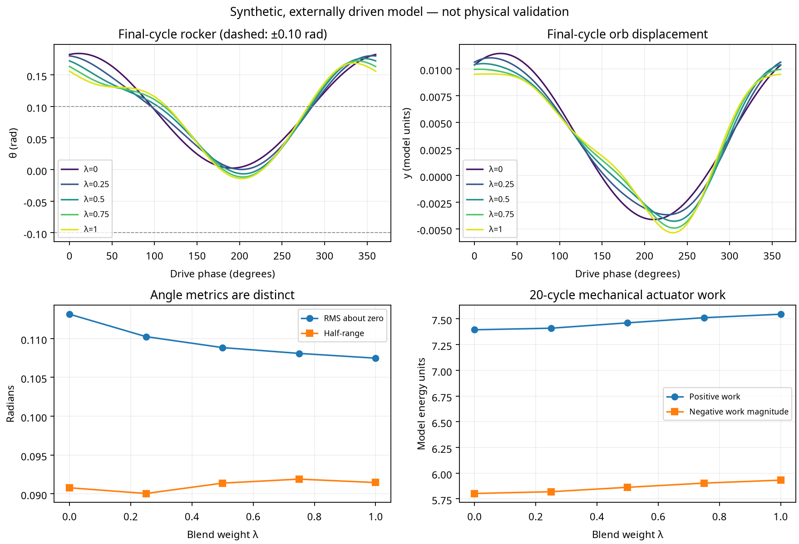

# Results — five fixed rocker-law blends

**Synthetic, deterministic and externally driven; not a test of physical reality.** These are model-unit outputs for the predeclared experiment in [PROTOCOL.md](PROTOCOL.md). No fitted or measured inputs or probabilities are involved. λ=0 and 1 exactly recover the newer **rocker-law** A and B; this is not the older damping A/B fork. For definitions and parameters see [README.md](README.md).

## Final-cycle motion and transition

| λ | θ min | θ max | RMS θ about zero | θ half-range | Fraction in 0.10–0.24 rad | Zero crossings |
|---:|---:|---:|---:|---:|---:|---:|
| 0 | 0.002379 | 0.183932 | 0.113130 | 0.090776 | 0.4750 | 0 |
| 0.25 | 0.000211 | 0.180296 | 0.110240 | 0.090042 | 0.4708 | 0 |
| 0.50 | −0.006703 | 0.176054 | 0.108829 | 0.091379 | 0.5000 | 2 |
| 0.75 | −0.011721 | 0.172064 | 0.108083 | 0.091892 | 0.5292 | 2 |
| 1 | −0.014270 | 0.168631 | 0.107469 | 0.091451 | 0.5375 | 2 |

Angles are radians. Minima and maxima are sampled; RMS uses trapezoidal time integration of squared angle, including its nonzero mean. The occupancy counts 240 distinct final-cycle samples satisfying `0.10<|θ|<0.24`; at λ=0 these thresholds are merely markers because A has no transition. All cases have two sampled/interpolated velocity sign reversals in the final cycle. At these 4,801 stored baseline samples, the largest `|θ|` at **any** time is 0.218548, 0.213030, 0.208534, 0.204733 and 0.201483 respectively. Thus none of the baseline samples reaches the `0.24` upper threshold; the steeper, fully transitioned linear branch is checked mathematically, but not visited in these sampled baseline trajectories. Counts and extrema are sampling estimates, not exact continuous-time measurements. No 90° physical rotation is shown.

The response is not ranked by one universal measure. Across these five examples the smallest final-cycle **RMS angle about zero** and smallest positive maximum occur at λ=1, while the smallest **half-range** occurs at λ=0.25, and the least 20-cycle **positive** actuator work occurs at λ=0. The angle's mean also decreases from 0.093155 at λ=0 to 0.088701 at λ=1, explaining why RMS about zero and oscillation half-range can tell different stories. The smallest 20-cycle **net** actuator work and damping loss in this grid occur at λ=0.25. These are metric- and scenario-dependent numerical comparisons, not proof that a weight is best outside this experiment or even between the sampled weights.

## Energy and external work over 20 cycles

| λ | Positive actuator work | Negative-work magnitude | Net actuator work | Passive loss Q | ΔH | Max absolute energy residual |
|---:|---:|---:|---:|---:|---:|---:|
| 0 | 7.39377 | 5.80243 | 1.59135 | 1.48034 | 0.111012 | 5.60e−12 |
| 0.25 | 7.40894 | 5.81969 | 1.58925 | 1.47730 | 0.111947 | 3.34e−10 |
| 0.50 | 7.46119 | 5.86261 | 1.59858 | 1.48687 | 0.111709 | 1.77e−9 |
| 0.75 | 7.51115 | 5.90332 | 1.60782 | 1.49692 | 0.110902 | 2.68e−9 |
| 1 | 7.54501 | 5.93221 | 1.61280 | 1.50277 | 0.110022 | 1.83e−9 |

Positive/negative work is integrated separately for **each** control; its four individual values and complete histories are in `output/summary.json` and `output/trajectories.npz`. The reported residual is `H−H0−ΣW+ +ΣW−+Q`. Damping inside the controller is included in its signed mechanical work, not counted again as passive loss. The constant load's potential is in `H`. Inputs supply energy externally; negative work is extracted from the modeled mechanics, with its later destination unspecified. Gross work is not total electrical energy or efficiency.

## Same-drive matched perturbations

Both signs begin at physical-state Euclidean distance 0.0565685 from their λ-specific baseline; initial `θ` and `y` are shifted together by ±0.04 and all other initial coordinates, velocities, drives and settings are unchanged. The norm mixes coordinates and velocities in model units.

| λ | + pair at cycle 1 | − pair at cycle 1 | + at cycle 5 | − at cycle 5 | + at cycle 20 | − at cycle 20 |
|---:|---:|---:|---:|---:|---:|---:|
| 0 | 0.032362 | 0.032362 | 0.000883 | 0.000883 | 1.87e−9 | 1.87e−9 |
| 0.25 | 0.032062 | 0.032127 | 0.000700 | 0.000717 | 1.57e−9 | 1.64e−9 |
| 0.50 | 0.033534 | 0.033000 | 0.000770 | 0.000772 | 9.47e−10 | 9.65e−10 |
| 0.75 | 0.035638 | 0.034623 | 0.000801 | 0.000820 | 9.44e−10 | 9.53e−10 |
| 1 | 0.037736 | 0.036544 | 0.000663 | 0.000676 | 8.96e−10 | 9.20e−10 |

The distances can initially grow: the maximum over time for each pair is approximately 0.09256–0.09262. End-of-cycle-20 values are comparable to the tighter-solver state discrepancies, so their last digits and apparent ordering are not reliable convergence rates. These two perturbation directions provide finite-time examples only; they do not establish general stability, a basin, a limit cycle, or self-sustaining motion.

## Numerical and integrity checks

- **Exact endpoints:** both 20-cycle `λ=0` and `λ=1` sampled trajectories, including all 25 state/ledger components, match fresh calls to the unchanged original reference A and B integrators bit-for-bit here. They also independently match the existing archived A/B trajectory CSVs at all 4,801 time samples and state entries. Local source SHA-256 matches the archived source. Endpoint pointwise force, potential and vector field also match exactly.
- **Mathematics and energy:** finite-difference tests cover rocker and full eight-coordinate force gradients at all five weights and both transition boundaries, plus the instantaneous driven energy identity and continuity. Unforced lossless and damped checks behave as expected. The worst baseline integrated-energy residual above is `2.68e−9` model-energy units.
- **Solver comparisons:** over both baseline and `+` pairs at all weights, the maximum absolute normal-versus-tighter **physical-state component** difference at the saved samples is `6.81e−9`; the maximum difference of a cumulative **ledger component** is `4.71e−6`. These are comparisons with one tighter run, not mathematically certified error bounds. Gross split-work integrals have nonsmooth rates at sign changes, and their differences are much larger than the net balance residual; do not infer their accuracy from energy cancellation.
- **Important failed numerical check:** although the mathematical derivatives of `W+`, `W−` and `Q` are nonnegative, the sampled numerical **gross-work** accumulations were *not* monotone to the `1e−9` increment threshold. Across the five normal baselines there were 161 component/sample decreases larger than that threshold; across the tighter baselines, 6. The worst normal baseline increment was `−3.81e−7`; the worst tighter baseline was `−1.35e−8`. Across the `+` perturbed runs the worst normal increment was `−4.20e−6` at λ=0.75; the worst tighter increment was `−8.08e−8` at λ=0.25. At the worst λ=0.75 normal interval the corresponding tighter increment is positive `2.35e−7`. Interpolation/integration near power sign changes is a plausible cause; it has not been proven exhaustively. Passive `Q` passed this same monotonicity check. The program reports every affected run and its count, index and component without clamping or altering data. The initial failing log is retained as `run_initial.log`; the subsequent reporting-only amendment is recorded in `PROTOCOL.md`. Independent, sign-aware or event-split quadrature and further convergence checks would be needed before relying on high-precision gross work.
- **File integrity and tests:** all 28 saved numeric arrays round-trip exactly with expected shapes and finite values; all baseline and summary CSV row/column checks pass; all ten output-file SHA-256 checks pass. **15/15 unit tests pass**, including tests that accurately reproduce the monotonicity warning; passing tests do not turn that flagged numerical check into a pass. Full logs are `tests.log`, `run.log` and `checksum.log`.

The output values and figures are reproducible calculations within the stated model only. There is no measured geometry, observed dataset, physical bath, real motor, actuator limitation, independent evidence, or numerical proof of global behavior.
