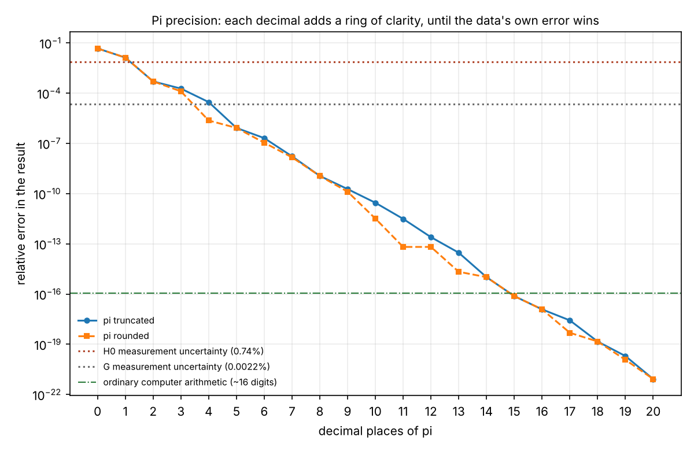

# The π precision test: true, truer, truest

*Uniquea · run November 11, 2026 · Stephen M. Griffin (Phantom.O.Vanish) · ORCID 0009-0005-8386-3999*

**Status: Tested.** Phantom's claim that each decimal place of π adds clarity holds for the mathematics through the first 31 decimals. For measured physics it holds only until π's error falls below the data's own error, which takes 2 to 5 decimals for the samples here.

## The owner's request

"Recalculate Uniquea data using π with 15 decimals as Option A, and Option B: if Phantom is correct, expand decimal places one or two at a time. Phantom has proven each decimal place adds some level of clarity. Run a test on selected samples of data; we will see trends. Trends leading in one direction will be evident, like rings inside of a family tree."

## Method

- **Reference ("truest"):** π to 50 decimals, computed at 60 significant digits (Python's Decimal), so the reference is far more exact than anything tested.
- **Option A:** each sample computed with π to **15 decimals** (3.141592653589793), the precision of ordinary computer arithmetic, and NASA JPL's working value for interplanetary navigation.
- **Option B:** π expanded one decimal at a time from 0 to 20, both **truncated** (3.1415) and **rounded** (3.1416), and the relative error of each result recorded.
- **Data uncertainty:** each physical sample also carries the uncertainty of its measured inputs. More digits of π cannot beat it.

## The samples

| Sample | Truest value | Measured input limits it to | π decimals needed* |
|---|---|---|---|
| cH₀/2π, the a₀ lead | 1.042197881144601 × 10⁻¹⁰ m/s² | H₀ = 67.4 ± 0.5: 0.74% | **2** |
| Earth's circumference 2πR (R = 6,371.0 km) | 40,030.17359204115 km | Earth is not a sphere: about 0.3% | **3** |
| Upper tap c⁴/(80πG) | 4.815453886722422 × 10⁴¹ N | G: 0.0022% | **5** |
| KFA = 8π²G/c⁸ (V18, Law 22) | 8.076623394727839 × 10⁻⁷⁷ | G: 0.0022% | **5** |
| e^(−π) (the withdrawn 0.0432) | 0.04321391826377225 | pure math, no measurement | every one |

\*The decimal place at which π's error drops below one-tenth of the data's uncertainty. After that point, π is no longer the weak link.

**Option A result:** with 15 decimals every sample agrees with the truest value to about **1 part in 10¹⁶**, the limit of ordinary computer arithmetic. For every physical sample, that is 10¹¹ to 10¹⁴ times more precise than its data.

## The trend (Option B)

For cH₀/2π, the relative error at each step:

| π used | Truncated | Rounded |
|---|---|---|
| 3 | 4.7 × 10⁻² | 4.7 × 10⁻² |
| 3.1 | 1.3 × 10⁻² | 1.3 × 10⁻² |
| 3.14 | 5.1 × 10⁻⁴ | 5.1 × 10⁻⁴ |
| 3.141 / 3.142 | +1.9 × 10⁻⁴ | −1.3 × 10⁻⁴ |
| 3.1415 / 3.1416 | +2.9 × 10⁻⁵ | −2.3 × 10⁻⁶ |
| 3.14159 | 8.4 × 10⁻⁷ | 8.4 × 10⁻⁷ |
| 3.14159265 (8 decimals) | 1.1 × 10⁻⁹ | 1.1 × 10⁻⁹ |
| 15 decimals | 7.6 × 10⁻¹⁷ | 7.6 × 10⁻¹⁷ |
| 20 decimals | 8.4 × 10⁻²² | 8.4 × 10⁻²² |

## What the rings show

1. **One ring per decimal.** On the log chart the error falls in a near-straight line, about **ten times smaller per decimal**, like growth rings laid down year after year. The steps vary with the size of each digit, as rings vary with each year's weather.
2. **Truncation trends in one direction (Phantom's prediction, confirmed).** Truncated π is always a little low, so results that divide by π always come out a little high. The error never changes sign; it only shrinks. That is "trends leading in one direction."
3. **Rounding zigzags.** Rounded π overshoots at some steps (3.142, 3.1416) and undershoots at others, so its errors flip sign. It reaches the truth faster but not in one direction.
4. **Every decimal adds clarity in the math, through the 31st.** Each truncation step strictly reduces the error, because no decimal of π is zero until the **32nd** (…3279**5**0288…). There, truncating gains nothing: a ring with no growth, a drought year in the tree.
5. **Measurement sets the ceiling.** For cH₀/2π, π beyond 2 decimals adds nothing a measurement could notice, because H₀ is known only to 0.74%; for G-limited quantities, beyond 5. More digits sharpen the arithmetic, not the knowledge. HAT: say where you rounded, and know which error is the larger.

## Verdict

- **Phantom's claim, mathematics:** **Established** (Derived, and run). Each decimal adds clarity through the 31st decimal, with truncated errors trending one way.
- **Phantom's claim, physics:** **Holds until the data's own error wins**: 2 decimals for the a₀ lead, 3 for Earth's circumference, 5 for anything limited by G. Option A (15 decimals) is more than enough for every Uniquea number on file.
- **The rule it gives:** *true, truer, truest*: use enough decimals that π is never the weakest link, report where you rounded, and spend the remaining effort on the measurement.

## Beside the earlier answer

The public Master also holds **"More π digits, more accuracy? (Phantom, November 10, 2026; Tested, answered no)"**, from an earlier session. The two results agree on the facts and differ only in the question asked: **yes in the math** (each decimal shrinks π's error, through the 31st), **no in the measurement** (once π is finer than the data, results do not change). Both are kept (House Rule 11).

*Files: pi_precision.py (the run), results.csv (every step, both modes), summary.json, pi_precision.png.*

## Digit by digit (November 12, 2026)

`pi_digit_steps.csv`: each truncation step shrinks the error between 2.7× (adding a 1) and 34.9× (adding a 9), 9.7× on average (geometric mean). Flipped, the error climbs about 0.98 powers of ten per decimal; the running sum of the digits climbs about 5.1 per decimal (4.5 expected for random digits); the two correlate at 0.993, but 2,000 sets of random digits correlate at a median 0.990, so the match comes from the shared ladder of decimals, not a hidden signal in π. *Metaphor (owner):* "one measure Lila and one Lisa": the clarity line is Lisa (nearly straight), the digit sum Lila (the same climb with a wobble at every step).

*We marvel and we measure.*
